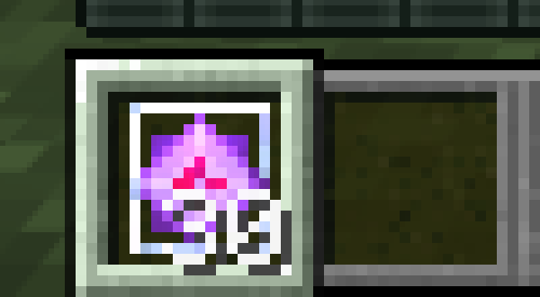
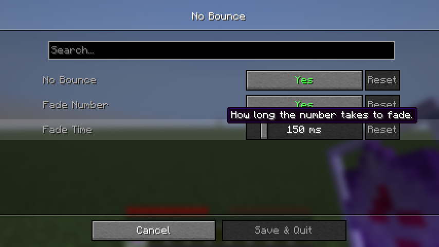

# No Bounce

on high ping your client places a crystal and counts it as used, then the server gives it back and your hotbar item jumps up and the number snaps to the old one. this mod removes the jump and fades the number into the new number instead.

client side fabric mod for 1.21.11. settings with the menu (key **Z** or mod menu, needs [Wysss Library](https://github.com/realwysss/Wysss-Library)):

- **no bounce**: removes the pop animation of the hotbar item when the server hands items back (works for every item, not just crystals)
- **fade number**: the stack number fades from the old number into the new one instead of snapping
- **fade time**: how long the fade takes, 20 to 1000 ms (default 150 ms)

## download

`no-bounce-mc1.21.11-1.1.0.jar` on the releases page. minecraft 1.21.11, fabric loader 0.16 or newer.

## pictures

the number 20 fading into 12, the screenshot is taken in the middle of the fade (slowed down to 4 seconds so it can be caught):

## how it works

the game starts a short pop animation on a hotbar item whenever a slot update from the server has a bigger count than your client has. the mod makes that animation time always zero. the number is drawn by a mixin on the item count drawing: when the count of a slot changes it draws the old number and the new number on top of each other with opposite transparency for a short time.

all rights reserved. made by wysss.
